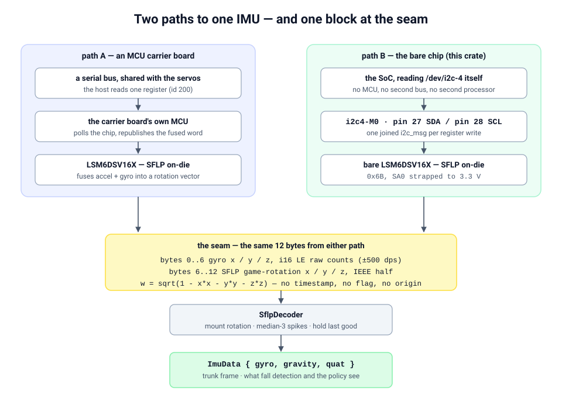

# lsm6dsv16x-sflp

**A bare LSM6DSV16X on I²C, assembled into the 12-byte SFLP block an `imu_to_dxl` v2 board
serves — so the choice between a bare chip and an MCU carrier board is invisible downstream.**

[](LICENSE)
[](https://www.rust-lang.org)
[](https://doc.rust-lang.org/edition-guide/rust-2024/)
[](#api)

ST's [LSM6DSV16X](https://www.st.com/en/mems-and-sensors/lsm6dsv16x.html) has an on-die
sensor-fusion block (**SFLP**) that fuses the accelerometer and the gyroscope and emits a
**game-rotation vector**. The usual way to reach it is a small MCU on a carrier board that
polls the chip and republishes the result on another bus.

This crate is the other route: wire the chip to your SoC's own I²C controller, read the
registers directly, and **build the same 12 bytes the MCU board serves** — plus the decoder
that turns those bytes into an attitude, so the whole path from a register read to a gravity
vector is here without an application framework around it.

The interesting part is not the register map. It is the three ways this fails **silently**:

| # | trap | what it looks like |
|---|---|---|
| 1 | a register write split across two I²C messages | the chip ACKs every byte, **drops** the payload, and every readback agrees with itself — the bring-up is green and nothing fuses |
| 2 | the gyroscope full scale set to ±250 dps | no error anywhere; every angular rate is wrong by a factor of two, because the decoder scales for ±500 dps |
| 3 | the mounting rotation copied from another board | the robot reports itself upside down while standing still, with every register readback agreeing |

All three are pinned by **tests**, not comments — a comment cannot fail a build.



*Two ways to reach the same part, one wire format where they meet. The seam — and why making
the two paths interchangeable is the whole design — is
[docs/design.md §2](docs/design.md#2-two-routes-to-one-part-and-the-seam-between-them).*

```rust
use lsm6dsv16x_sflp::{BoardBodyImu, SflpDecoder, MOUNT};

let bus = linux_embedded_hal::I2cdev::new("/dev/i2c-imu")?;
let mut imu = BoardBodyImu::new(bus, lsm6dsv16x_sflp::ADDRESS);
imu.configure()?;

let mut decoder = SflpDecoder::new(MOUNT);   // MOUNT is per-board — measure your own
loop {
    let block = imu.read_block()?;           // 12 bytes, same as the MCU board's
    let attitude = decoder.decode(&block);
    if decoder.ready() {                     // ~0.25 s of live fused output
        println!("gravity = {:?}", attitude.gravity);
        break;
    }
}
```

## Contents

- [Why](#why)
- [Wiring](#wiring)
- [Quick start](#quick-start)
- [API](#api)
- [The register map](#the-register-map)
- [Measured](#measured)
- [Tests](#tests)
- [Honest unknowns](#honest-unknowns)
- [Documentation](#documentation)
- [License and acknowledgements](#license-and-acknowledgements)

## Why

- **One IMU, one code path.** The bare chip and the MCU board produce *byte-identical*
  12-byte blocks. `assembled_block_decodes_identically_to_the_mcu_board` writes the MCU
  board's bytes out literally, builds the same sample with `assemble_block`, and asserts two
  independent decoders return equal `ImuData` for four ticks. Fall detection, policy
  observation and logging never learn which path is live.
- **No MCU, no second bus, no second processor.** The SoC reads the chip itself, so the
  register-level behaviour is visible to the thing that needs the attitude — and a wiring
  question is answered with a Python script, not a firmware flash.
- **The failure modes are named and tested.** The three silent traps above are the reason
  this crate exists as a thing you can depend on rather than a sequence of `i2cset` calls.
- **Small and honest.** One dependency for the driver core (`embedded-hal`), one for errors
  (`thiserror`). No filter is applied that was not measured, and the things that were *not*
  measured are written down in [Honest unknowns](#honest-unknowns).

## Wiring

| chip pin | to | note |
|---|---|---|
| `VDD` | 3.3 V | |
| `VDD_IO` | 3.3 V | |
| `GND` | GND | |
| `SCL` | host I²C SCL | 40-pin **pin 28** on the board this was built on |
| `SDA` | host I²C SDA | 40-pin **pin 27** |
| `SA0` | **3.3 V** | sets the address — `0x6B` high, `0x6A` low |
| `CS` | 3.3 V | selects I²C |

> **Tie `SA0` to a rail — do not leave it floating.** Floating is not a third state; it picks
> up whatever the trace is near. One board showed the part at `0x6A` and `0x6B` alternately
> at ~50 Hz, surfacing as `ENXIO` from the kernel with no pattern in the data.

> **Do not scan the bus for this part.** It is strappable only between `0x6A` and `0x6B`, and
> `ADDRESS` is a constant rather than a scan result. A scan can only find the wrong thing.

Full detail — enabling the controller, the udev alias, pull-ups: [docs/bring-up.md](docs/bring-up.md#1-wiring).

## Quick start

**Before any Rust.** The Python probe needs no compilation and answers "is this chip there,
is it this part, is it fusing?" in one run. It writes no register unless you let it:

```sh
python3 tools/body_imu_probe.py --bus /dev/i2c-4 --address 0x6B   # exit 0 = all three checks pass
python3 tools/body_imu_probe.py --read-only                       # i2cdetect + WHO_AM_I only
```

Then the Rust bench, which is where the numbers below come from:

```sh
cargo build --release
./target/release/bench_imu --bus /dev/i2c-4 --hz 50 --seconds 10
```

As a dependency:

```toml
[dependencies]
lsm6dsv16x-sflp = { git = "https://github.com/sim336/lsm6dsv16x-sflp" }
```

> Not on crates.io yet — pull it straight from the repository above.

## API

| item | what it is |
|---|---|
| `BodyImu<P: I2c>` | the driver. Generic over `embedded-hal`'s `I2c`, **no platform dependency** — `configure`, `read_block`, `read_block_with_fifo`, `configuration_readback`, `who_am_i`. |
| `BoardBodyImu` | `BodyImu<linux_embedded_hal::I2cdev>`, the `/dev/i2c-*` spelling. Linux only. |
| `assemble_block` | the 12-byte wire format, a free function so it can be tested in isolation. |
| `SflpDecoder` | bytes in, `ImuData` out. Also in this crate, so the path is end to end. |
| `stale::StaleImuTracker` | the "the chip answers but stopped refreshing" fault. |
| `FifoReport` | what the FIFO looked like — the only way to tell a live word from an empty tick, which produce identical blocks. |
| `MOUNT` | the mounting rotation, **measured per board**. See [Honest unknowns](#honest-unknowns). |
| `bench_imu` | the bring-up binary (Linux). |

The crate is `std` (the point of this path is a Linux SoC reading `/dev/i2c-*`), but the
driver core has no platform dependency at all — off Linux everything builds and every test
runs; only `BoardBodyImu` and the bench binary are missing, so you can iterate on the
register map and the decoder on a laptop.

The register map is written out in this crate rather than taken from a crate. ST publishes
one (`lsm6dsv16x-rs`) and it is the first thing to reach for — but every release of it
depends on a `bisync` release that is yanked from crates.io and cannot be resolved. What is
left is the datasheet and a working reference on real hardware.

## The register map

Ten registers, main page then embedded-function page. Values and the reasoning behind each —
including the `SFLP_ODR = 0x18` field-in-`[5:3]` trap — are in
[docs/register-map.md](docs/register-map.md).

| register | addr | value | why |
|---|---|---|---|
| `CTRL3` | `0x12` | `0x44` | block-data-update + address auto-increment |
| `CTRL1` | `0x10` | `0x07` | accel 240 Hz, high performance |
| `CTRL2` | `0x11` | `0x07` | gyro 240 Hz, high performance |
| `CTRL6` | `0x15` | `0x02` | **±500 dps — a contract with the decoder** |
| `CTRL8` | `0x17` | `0x02` | ±8 g |
| `FIFO_CTRL3` | `0x09` | `0x00` | no raw sensor batched — they are read directly |
| `FIFO_CTRL4` | `0x0A` | `0x06` | stream mode |
| `SFLP_ODR` `*` | `0x5E` | `0x18` | `SFLP_GAME_ODR = 011` (120 Hz) in bits **[5:3]** |
| `EMB_FUNC_EN_A` `*` | `0x04` | `0x02` | turn the fusion block on |
| `EMB_FUNC_FIFO_EN_A` `*` | `0x44` | `0x02` | put the fused word in the FIFO |

`*` embedded-function page: reachable only while `FUNC_CFG_ACCESS` (`0x01`) = `0x80`, and the
gate is shut again on every path.

## Measured

Not a promise about your board — what **one** board (Radxa Zero 3, RK3566) actually did, at
50 Hz over `/dev/i2c-4` at `0x6B`. Run `bench_imu` and read your own.

| | | |
|---|---|---|
| `WHO_AM_I` | `0x70` | |
| configuration readback | **10 / 10** registers read back as written | no dropped write |
| throughput | **1501 ticks in 30.0 s — 50.0 Hz** | 1501 SFLP words, **0 errors** |
| read time | mean **3.5–4.3 ms**, p95 **4.0–4.9 ms**, max **5.3 ms** | inside a 20 ms tick — about 20% of it |
| tick jitter | p95 **40–170 µs**, worst **907 µs** | |
| FIFO empty | **0%** | |
| SFLP word present | **100%** | fused output every tick |
| `|g|`, `|q|` | **1.000**, **1.000** | gravity and quaternion are unit vectors |

**Where the read fits.** mean 3.5–4.3 ms against a 20 ms tick means a read can be done
*inside* a 50 Hz control loop, which is what `read_block` assumes. If your numbers say
otherwise, the fallback shape is a thread that publishes the newest `ImuData` — but do not
assume it, measure it.

### The `attitude` line, read honestly

```text
attitude  gravity=[-0.367, -0.014, +0.930]  quat(wxyz)=[-0.180, +0.232, +0.955, +0.051]
```

Two things this says, both worth noticing:

- **It is not `[0, 0, -1]`** — because the robot was **not in the upright pose the mounting
  rotation was calibrated in** at the time. This is not an error; it is what §7 of
  [design.md](docs/design.md#7-the-mounting-rotation) tells you to expect, and it is the
  measurement you have to redo for your own board. An upright board must print
  `gravity=[+0.000, +0.000, -1.000]`.
- **The quaternion's yaw component moved between two runs while gravity did not.** A
  game-rotation vector has **no magnetometer**, so there is **no absolute heading** — yaw
  drifts, and gravity is unaffected by it. Anything needing an absolute heading needs a
  magnetometer this chip does not have.

## Tests

```sh
cargo test        # 22 tests, no hardware
cargo clippy --all-targets
cargo fmt --check
```

The tests are the specification of the three traps. A `Recorder` mock implements
`embedded_hal::i2c::I2c` and records the **shape** of every transaction — one operation or
two — because that shape is what the chip silently discards:

| test | trap |
|---|---|
| `every_register_write_is_a_single_i2c_message` | 1 — shape, not bytes |
| `gyro_full_scale_matches_the_decoder` | 2 — reads `FS_G` out of the byte written and maps it through the datasheet, instead of restating the constant |
| `mount_reports_the_upright_calibration_as_upright` | 3 — and asserts `V2_BOARD_MOUNT` gives the mirror image |
| `assembled_block_decodes_identically_to_the_mcu_board` | the seam |
| `no_sflp_word_holds_the_last_quaternion` | empty tick ≠ snap to upright |
| `fifo_report_tells_a_live_word_from_an_empty_fifo` | the block cannot say it is empty |
| `a_backlog_is_drained_up_to_the_cap` | the per-tick drain cap |
| `who_am_i_must_be_0x70` | a stranger is refused **before** any write |

No hardware is needed. `configure()` against the mock is the real bring-up sequence; the
mock models a dropped write faithfully.

## Honest unknowns

The things that are *not* measured are written down here rather than left implied:

- **`MOUNT` is per board.** It describes how the chip was bolted on, not the chip. Yours is
  almost certainly different — a different mount is a robot that reports itself upside down
  with every readback agreeing. **Measure it** ([docs/bring-up.md](docs/bring-up.md#7-measure-your-mounting-rotation)).
- **No filters, on purpose.** Gyro LPF1 and accel LPF2 are off: a comparable board's filter
  settings are generally not published, so no choice here could be checked against one. Raw
  counts go to the decoder, which rejects single-sample spikes with a median over three.
- **`SW_RESET` / `BOOT` are not issued.** `configure` writes every register it depends on,
  so a warm chip left by another process is as well-defined as a cold one — by construction,
  not by measurement.
- **Gyro noise across temperature is not characterised.** The median filter and the fused
  quaternion cover the same ground a temperature sweep would, but that is an argument, not a
  measurement.
- **`imu2uart`'s reference C driver was not copied here.** Its copyright ownership is
  undetermined, and nothing in this crate needs it. Where this crate differs from it
  deliberately (the full scale, the SFLP ODR field, the filters), the difference is called
  out. See [NOTICE](NOTICE).

## Documentation

| | |
|---|---|
| [docs/design.md](docs/design.md) | why, the two paths, and the seam — the reasoning behind every choice |
| [docs/bring-up.md](docs/bring-up.md) | wiring, the four checks, the tools, and a troubleshooting table |
| [docs/register-map.md](docs/register-map.md) | every register, its value, and the reason |
| [`tools/`](tools/) | five Python probes — no compilation, run on the target |

## License and acknowledgements

Apache-2.0. See [LICENSE](LICENSE) and [NOTICE](NOTICE).

`SflpDecoder`, `ImuData`, the half-precision decoding, the quaternion helpers and the stale
tracker are derived from [`pollen-robotics/microduck`](https://github.com/pollen-robotics/microduck)
(`duck-control`), also Apache-2.0; the per-file changes are listed in [NOTICE](NOTICE). The
mounting calibration and every measured number in this repository were measured on the
authors' own hardware.