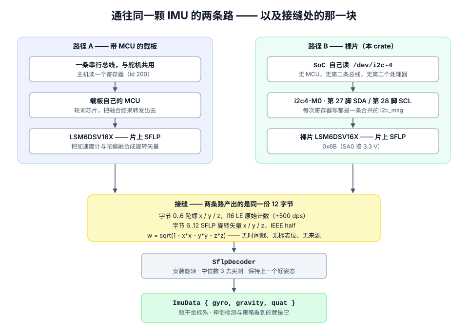

# lsm6dsv16x-sflp

**裸片 LSM6DSV16X 直接挂在 I²C 上，由 SoC 直读，组装成 `imu_to_dxl` v2 板在总线上提供的同一份 12 字节块 —— 于是「裸片」还是「带 MCU 的载板」这个选择，对下游完全不可见。**

[](LICENSE)
[](https://www.rust-lang.org)
[](https://doc.rust-lang.org/edition-guide/rust-2024/)
[](#api)

ST 的 [LSM6DSV16X](https://www.st.com/en/mems-and-sensors/lsm6dsv16x.html) 片上带一块
传感器融合单元（**SFLP**），它把加速度计和陀螺仪融合后输出一个 **game-rotation vector**
（游戏旋转矢量，四元数）。通常拿到它的办法是在一块载板上放一颗小 MCU，由 MCU 轮询芯片、
再把融合结果转发到另一条总线上。

这个 crate 走的是另一条路：把裸片接到 SoC 自己的 I²C 控制器上，直接读寄存器，**组装出与
MCU 载板完全相同的 12 字节**，并附带把这些字节解成姿态的解码器 —— 从一次寄存器读到一个
重力向量，整条链路都在这里，不需要外面的应用框架。

有意思的部分不是寄存器表，而是这条路上会**静默**失效的三个地方：

| # | 陷阱 | 表现 |
|---|---|---|
| 1 | 一次寄存器写被拆成两条 I²C 消息 | 芯片对每个字节都 ACK，然后把载荷**丢掉**，而且所有回读都自洽 —— bring-up 全绿，但融合块根本没跑 |
| 2 | 陀螺满量程被设成 ±250 dps | 哪里都不报错；因为解码器是按 ±500 dps 定标的，所以每一个角速度都错一倍 |
| 3 | 安装旋转从另一块板抄过来 | 机器人静止不动却报告自己倒过来了，而总线上的每一个回读都自洽 |

这三条都用**测试**钉住，而不是注释 —— 注释不会让编译失败。



*两条路通向同一颗芯片，在同一个线上格式处汇合。关于这个接缝 —— 以及为什么「让两条路可
互换」就是整个设计 —— 见 [design.md 第 2 节](docs/design.md#2-two-routes-to-one-part-and-the-seam-between-them)。*

```rust
use lsm6dsv16x_sflp::{BoardBodyImu, SflpDecoder, MOUNT};

let bus = linux_embedded_hal::I2cdev::new("/dev/i2c-imu")?;
let mut imu = BoardBodyImu::new(bus, lsm6dsv16x_sflp::ADDRESS);
imu.configure()?;

let mut decoder = SflpDecoder::new(MOUNT);   // MOUNT 逐板而定 —— 务必自己测一次
loop {
    let block = imu.read_block()?;           // 12 字节，与 MCU 载板一致
    let attitude = decoder.decode(&block);
    if decoder.ready() {                     // 约 0.25 s 的实时融合输出之后
        println!("gravity = {:?}", attitude.gravity);
        break;
    }
}
```

## 目录

- [为什么需要它](#为什么需要它)
- [接线](#接线)
- [快速开始](#快速开始)
- [API](#api)
- [寄存器表](#寄存器表)
- [实测](#实测)
- [测试](#测试)
- [诚实的未知项](#诚实的未知项)
- [文档](#文档)
- [许可与致谢](#许可与致谢)

## 为什么需要它

- **一颗 IMU，一条代码路径。** 裸片和 MCU 载板产出的是**逐字节相同**的 12 字节块。
  `assembled_block_decodes_identically_to_the_mcu_board` 把载板的字节按其在线上读出来的
  样子逐字写死，再用 `assemble_block` 构造同一个采样，断言两个独立解码器连着四个 tick 返回
  相等的 `ImuData`。摔倒检测、策略观测、日志，都不需要知道现在是哪条路在跑。
- **没有 MCU、没有第二条总线、没有第二个处理器。** SoC 自己读芯片，所以寄存器级的行为对
  「需要姿态的那一方」是可见的 —— 一个接线问题用一个 Python 脚本回答，而不是烧一次固件。
- **失效模式被点名、被测试。** 上面那三个静默陷阱，正是它值得作为一个可依赖的库（而不是
  一串 `i2cset`）的理由。
- **小而老实。** 驱动核心只有一个依赖（`embedded-hal`），错误处理一个（`thiserror`）。
  没有施加任何未经测量的滤波器；**没测过的东西**都写在[诚实的未知项](#诚实的未知项)里。

## 接线

| 芯片引脚 | 接到 | 说明 |
|---|---|---|
| `VDD` | 3.3 V | |
| `VDD_IO` | 3.3 V | |
| `GND` | GND | |
| `SCL` | 主机 I²C SCL | 在本 crate 开发用的板子上是 40-pin **第 28 脚** |
| `SDA` | 主机 I²C SDA | 40-pin **第 27 脚** |
| `SA0` | **3.3 V** | 决定地址 —— 拉高 `0x6B`，拉低 `0x6A` |
| `CS` | 3.3 V | 选中 I²C |

> **`SA0` 必须接到电源轨 —— 不要悬空。** 悬空不是「第三种状态」，它会拾取走线附近的东西。
> 有一块板子上表现为器件在 `0x6A` / `0x6B` 之间以约 50 Hz 来回跳，在内核侧表现为 `ENXIO`，
> 数据里看不出任何规律。

> **不要扫描这条总线找它。** 它的地址只在 `0x6A` 和 `0x6B` 之间可跳，而 `ADDRESS` 是常量、
> 不是扫描结果。扫描只会扫到错的东西。

完整细节 —— 使能控制器、udev 别名、上拉电阻：[docs/bring-up.md](docs/bring-up.md#1-wiring)。

## 快速开始

**先别动 Rust。** Python 探针不需要编译，一次运行就回答「芯片在不在、是不是这颗、有没有在融合」，
而且除非你允许，它一个寄存器都不写：

```sh
python3 tools/body_imu_probe.py --bus /dev/i2c-4 --address 0x6B   # 退出码 0 = 三项全过
python3 tools/body_imu_probe.py --read-only                       # 只跑 i2cdetect + WHO_AM_I
```

然后是 Rust 台架程序，下面那些数字就来自它：

```sh
cargo build --release
./target/release/bench_imu --bus /dev/i2c-4 --hz 50 --seconds 10
```

作为依赖引入：

```toml
[dependencies]
lsm6dsv16x-sflp = { git = "https://github.com/sim336/lsm6dsv16x-sflp" }
```

> 暂未发布到 crates.io —— 直接从上面的仓库拉取。

## API

| 项 | 是什么 |
|---|---|
| `BodyImu<P: I2c>` | 驱动本体。对 `embedded-hal` 的 `I2c` 泛型，**零平台依赖** —— `configure`、`read_block`、`read_block_with_fifo`、`configuration_readback`、`who_am_i`。 |
| `BoardBodyImu` | `BodyImu<linux_embedded_hal::I2cdev>`，`/dev/i2c-*` 的写法。仅 Linux。 |
| `assemble_block` | 12 字节线上格式，做成自由函数以便单独测试。 |
| `SflpDecoder` | 字节进，`ImuData` 出。也在本 crate 内，所以整条链路是端到端的。 |
| `stale::StaleImuTracker` | 「芯片还答、但不再刷新」这个故障。 |
| `FifoReport` | FIFO 当时的样子 —— 区分「有活的融合词」和「空 tick」的唯一办法，而这两者产出的块完全相同。 |
| `MOUNT` | 安装旋转，**逐板测量**。见[诚实的未知项](#诚实的未知项)。 |
| `bench_imu` | bring-up 台架程序（Linux）。 |

本 crate 是 `std` 的（这条路的全部意义就是 Linux SoC 直读 `/dev/i2c-*`），但驱动核心完全
没有平台依赖 —— 在非 Linux 上一切照常构建、全部测试照常运行，只有 `BoardBodyImu` 和台架程序
缺席，所以你可以在笔记本上迭代寄存器表和解码器。

寄存器表写在本 crate 里，而不是取自某个 crate。ST 发布过一个（`lsm6dsv16x-rs`），那本是最该
先抓的东西 —— 但它每一个版本都依赖一个已被 crates.io yank 的 `bisync`，无法解析。剩下的就是
数据手册，和一份在真机上跑通的参考。

## 寄存器表

十个寄存器，先主页面、再内嵌功能页。每个的值和背后的理由 —— 包括
`SFLP_ODR = 0x18` 那个「字段在 `[5:3]`」的陷阱 —— 都在
[docs/register-map.md](docs/register-map.md)。

| 寄存器 | 地址 | 值 | 为什么 |
|---|---|---|---|
| `CTRL3` | `0x12` | `0x44` | 块数据更新 + 地址自增 |
| `CTRL1` | `0x10` | `0x07` | 加速度计 240 Hz，high performance |
| `CTRL2` | `0x11` | `0x07` | 陀螺仪 240 Hz，high performance |
| `CTRL6` | `0x15` | `0x02` | **±500 dps —— 与解码器的契约** |
| `CTRL8` | `0x17` | `0x02` | ±8 g |
| `FIFO_CTRL3` | `0x09` | `0x00` | 不批量缓存原始传感器 —— 它们直接读 |
| `FIFO_CTRL4` | `0x0A` | `0x06` | stream 模式 |
| `SFLP_ODR` `*` | `0x5E` | `0x18` | `SFLP_GAME_ODR = 011`（120 Hz）位于 bits **[5:3]** |
| `EMB_FUNC_EN_A` `*` | `0x04` | `0x02` | 打开融合块 |
| `EMB_FUNC_FIFO_EN_A` `*` | `0x44` | `0x02` | 把融合词放进 FIFO |

`*` 内嵌功能页：只有在 `FUNC_CFG_ACCESS`（`0x01`）= `0x80` 时可达，且每一条路径上都会重新关上。

## 实测

这不是对你这块板的承诺，而是**一块**板（Radxa Zero 3，RK3566）在 50 Hz、
`/dev/i2c-4` `0x6B` 上实际做出来的数字。请自己跑 `bench_imu` 读你自己的。

| | | |
|---|---|---|
| `WHO_AM_I` | `0x70` | |
| 配置回读 | **10 / 10** 个寄存器读回与写入一致 | 没有写丢 |
| 吞吐 | **30.0 s 内 1501 个 tick —— 50.0 Hz** | 1501 个 SFLP 词，**0 错误** |
| 读耗时 | 均值 **3.5–4.3 ms**，p95 **4.0–4.9 ms**，最大 **5.3 ms** | 装在 20 ms 的 tick 里 —— 约占 20% |
| tick 抖动 | p95 **40–170 µs**，最差 **907 µs** | |
| FIFO 空 | **0%** | |
| SFLP 词存在 | **100%** | 每个 tick 都有融合输出 |
| `|g|`、`|q|` | **1.000**、**1.000** | 重力与四元数都是单位向量 |

**读耗时能不能装进 tick。** 均值 3.5–4.3 ms 对 20 ms 的 tick，意味着一次读可以放在 50 Hz
控制环**内部**完成，这正是 `read_block` 的前提。如果你的数字不是这样，退路是开一个线程发布
最新的 `ImuData` —— 但别假设，去测。

### 把 `attitude` 那行老实读出来

```text
attitude  gravity=[-0.367, -0.014, +0.930]  quat(wxyz)=[-0.180, +0.232, +0.955, +0.051]
```

它说明两件事，都值得注意：

- **它不是 `[0, 0, -1]`** —— 因为当时机器人**并不在标定安装旋转时用的那个直立姿态上**。
  这不是错误，恰恰是 [design.md](docs/design.md#7-the-mounting-rotation) 第 7 节让你预期的
  结果，也是你必须为自己的板子重做的那次测量。直立的板子必须打印
  `gravity=[+0.000, +0.000, -1.000]`。
- **两次运行之间四元数的 yaw 分量变了，而 gravity 没变。** game-rotation vector
  **没有磁力计**，所以**没有绝对航向** —— yaw 会漂，而 gravity 不受它影响。任何需要绝对
  航向的东西，都需要这颗芯片没有的磁力计。

## 测试

```sh
cargo test        # 22 个测试，不需要硬件
cargo clippy --all-targets
cargo fmt --check
```

测试就是那三个陷阱的规格说明。一个 `Recorder` mock 实现了 `embedded_hal::i2c::I2c`，记录
每笔事务的**形状** —— 一个操作还是两个 —— 因为芯片静默丢掉的正是这个形状：

| 测试 | 陷阱 |
|---|---|
| `every_register_write_is_a_single_i2c_message` | 1 —— 断言形状，而非字节 |
| `gyro_full_scale_matches_the_decoder` | 2 —— 从写下去的那个字节里读出 `FS_G`、经数据手册换算，而不是把常量再抄一遍 |
| `mount_reports_the_upright_calibration_as_upright` | 3 —— 并断言 `V2_BOARD_MOUNT` 给出的是镜像 |
| `assembled_block_decodes_identically_to_the_mcu_board` | 那个接缝 |
| `no_sflp_word_holds_the_last_quaternion` | 空 tick ≠ 弹回直立 |
| `fifo_report_tells_a_live_word_from_an_empty_fifo` | 块本身说不出它是空的 |
| `a_backlog_is_drained_up_to_the_cap` | 每 tick 的排空上限 |
| `who_am_i_must_be_0x70` | 陌生器件在**任何写之前**就被拒绝 |

不需要硬件。对着 mock 跑 `configure()` 就是真实的 bring-up 序列；mock 忠实地模拟了「写被
丢掉」这种情形。

## 诚实的未知项

**没测过**的东西写在这里，而不是留给人猜：

- **`MOUNT` 逐板而定。** 它描述的是芯片怎么被拧上去的，不是芯片本身。你的几乎肯定不一样 ——
  一个错的 mount 就是一个「静止却报告自己倒过来、而所有回读都自洽」的机器人。**去测它**
  （[docs/bring-up.md](docs/bring-up.md#7-measure-your-mounting-rotation)）。
- **故意不加滤波器。** 陀螺 LPF1 与加速度计 LPF2 都关着：一块同类板的滤波设置通常不公开，
  所以这里任何选择都无从对照。原始计数直接进解码器，而解码器用「对三个取中位数」把单采样
  尖刺挡掉。
- **不发 `SW_RESET` / `BOOT`。** `configure` 把它依赖的每个寄存器都写一遍，所以一颗被别的进程
  留成热态的芯片，与冷启动一样是良定义的 —— 这是构造上的保证，不是测量。
- **陀螺噪声的温漂没有刻画。** 中位数滤波和融合四元数覆盖了温度扫频要覆盖的同一片地，但那是
  论证，不是测量。
- **`imu2uart` 的参考 C 驱动没有被收录。** 它的著作权归属未定，而本 crate 也不需要它。凡是本
  crate 与它有意不同的地方（满量程、SFLP ODR 字段、滤波器），差异都被点名了。见 [NOTICE](NOTICE)。

## 文档

| | |
|---|---|
| [docs/design.md](docs/design.md) | 为什么、两条通路、那个接缝 —— 每个选择背后的推理 |
| [docs/bring-up.md](docs/bring-up.md) | 接线、四步检查、工具、排错表 |
| [docs/register-map.md](docs/register-map.md) | 每个寄存器、它的值、以及理由 |
| `tools/` | 五个 Python 探针 —— 不需要编译，在目标板上直接跑 |

## 许可与致谢

Apache-2.0。见 [LICENSE](LICENSE) 与 [NOTICE](NOTICE)。

`SflpDecoder`、`ImuData`、half 精度解码、四元数辅助函数与 stale 跟踪器派生自
[`pollen-robotics/microduck`](https://github.com/pollen-robotics/microduck)（`duck-control`），
同为 Apache-2.0；逐文件的改动列在 [NOTICE](NOTICE) 中。安装标定与本仓库中所有实测数字，
都是在作者自己的硬件上测得的。